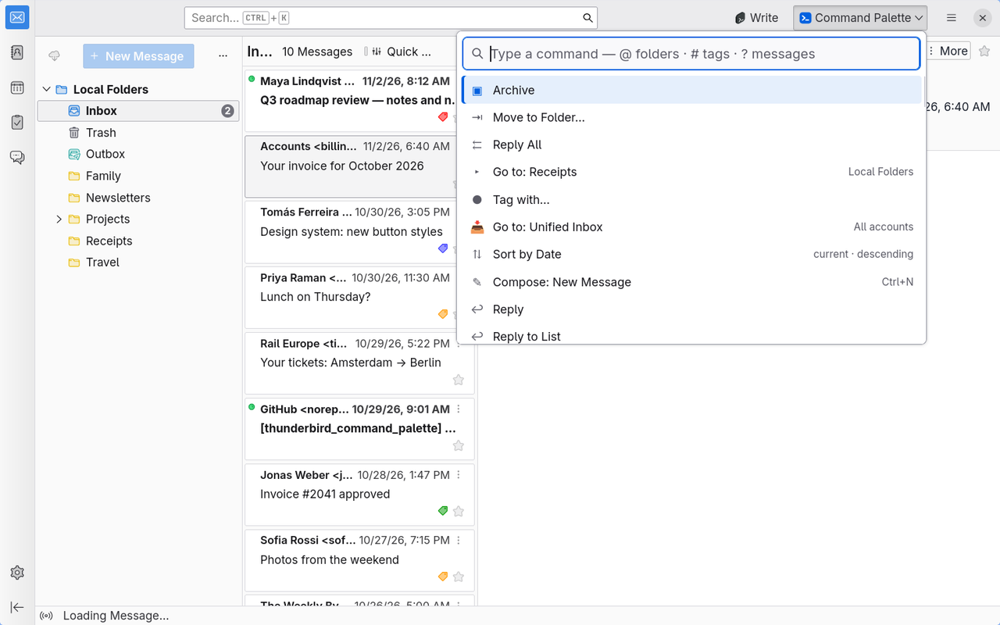
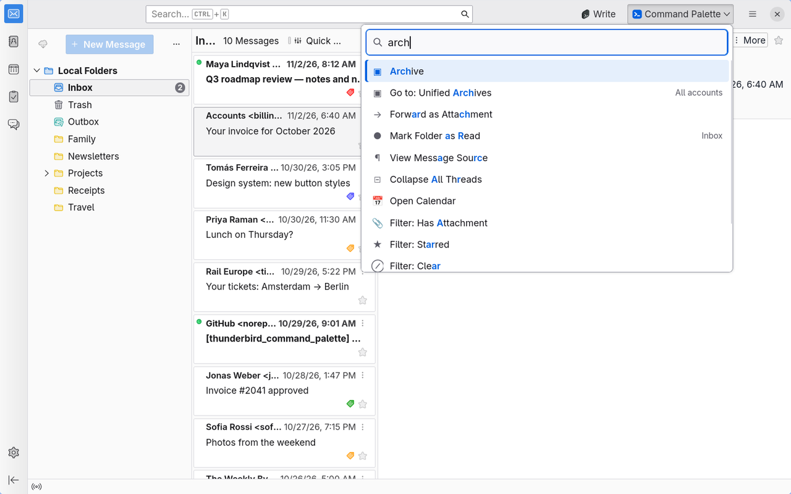
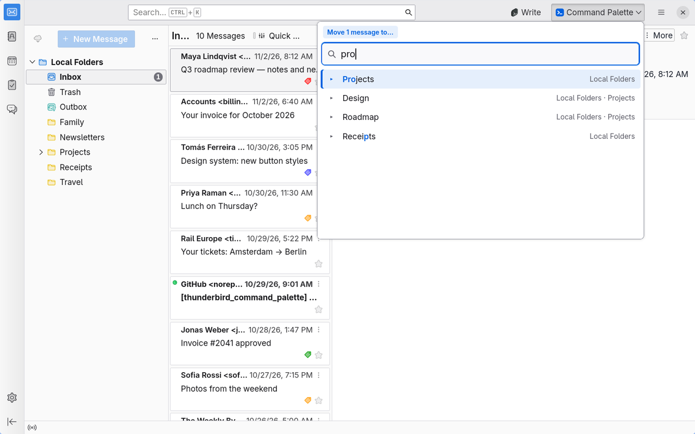
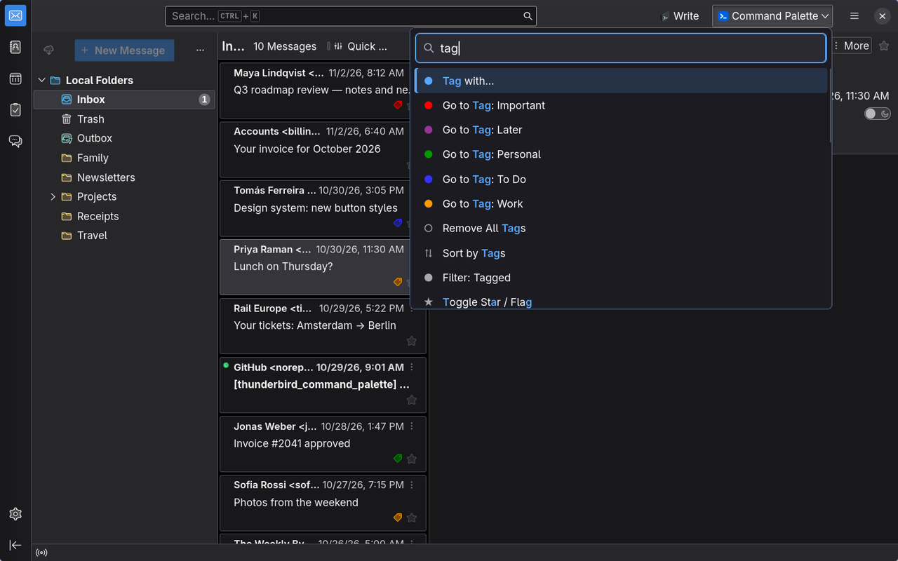

# Thunderbird Command Palette

The missing command palette for Thunderbird. Press <kbd>Ctrl</kbd>+<kbd>Shift</kbd>+<kbd>P</kbd> (<kbd>⌘</kbd>+<kbd>Shift</kbd>+<kbd>P</kbd> on macOS), type a few letters, and press <kbd>Enter</kbd>. It works like the command palette in VS Code. You can reply, archive, move messages, jump to folders, change the view, compose, search, and more without touching the mouse.



## Features

- **Fuzzy search** over every command and folder. Recently used commands are listed first.
- **Messages:**
  - reply, reply all, reply to list, forward;
  - mark read or unread, star, mark as junk (also moves to Junk);
  - archive, delete, open in a new tab or window, print\*, view source\*.
- **Move / Copy to Folder…** Pick a destination by typing part of its name. Recent destinations come first.
- **Folders:**
  - *Go to* any folder, or a unified folder (Unified Inbox, Sent, …);
  - mark a folder as read, add it to favourites, compact folders\*, empty trash.
- **Tags:** *Tag with…* toggles a tag on the selection, plus *Remove All Tags* and *Go to Tag*.
- **View:**
  - quick filters (unread, starred, attachments, contacts, tagged);
  - sort by any column, threaded or unthreaded view, expand or collapse all threads\*;
  - show or hide the folder and message panes, Classic / Wide / Vertical layout.
- **Navigation:** *Switch to Tab…*, *Write to…* a contact, open the Address Book, open Calendar / Tasks / Chat\*, toggle the Today pane\*.
- **In a compose window:** Send Later, Save as Draft or Template, *Send from…* another identity, set priority, request return or delivery receipts.
- **Undo / Redo**\*, Get New Mail\*, and quick access to Settings, Account Settings and Add-ons and Themes\*.
- **`about:` pages\*:** *Open about:config*, *Open about:support* and every other page `about:about` lists.
- **Other add-ons' commands\*:** every keyboard-shortcut command your other add-ons offer, and their toolbar, compose and message buttons, listed as *Add-on name: command*.
- Follows Thunderbird's **light/dark theme** and **font size**\*.

\* Needs the free [Command Palette Extras](#command-palette-extras) companion add-on.

| Fuzzy search | Move to Folder… | Dark theme |
|---|---|---|
|  |  |  |

## Using it

| Key | Action |
|---|---|
| <kbd>Ctrl</kbd>+<kbd>Shift</kbd>+<kbd>P</kbd> | Open the palette |
| <kbd>↑</kbd> <kbd>↓</kbd> | Move the selection |
| <kbd>Enter</kbd> | Run the selected command |
| <kbd>Esc</kbd> | Close, or go back from a sub-list like *Move to Folder…* |

Start your search with a prefix to narrow it down:

| Prefix | Shows | Example |
|---|---|---|
| `>` | commands only | `>sort` |
| `@` | folders only | `@inbox` |
| `#` | tags only | `#work` |
| `?` | search messages by subject or sender | `?invoice` |

Commands that can't be undone easily (*Delete*, *Empty Trash*, *Send Later*) ask you to press <kbd>Enter</kbd> a second time. They never move to the top of the list on their own.

### Extra shortcuts

You can bind keys directly to *Repeat Last Command*, *Move to Folder…*, *Tag with…*, *Switch to Tab…*, *Write to…*, *Go to Folder* (`@`) and *Search Messages* (`?`). They have no default keys, so they never clash with Thunderbird's own. To set them, go to **Add-ons and Themes → ⚙ → Manage Extension Shortcuts**, or run *Configure Keyboard Shortcuts* from the palette.

These shortcuts open the palette through its toolbar button, so keep the button on the toolbar.

## Install

Requires **Thunderbird 128** or later.

1. Download the latest `command-palette-<version>.xpi` from the [Releases page](https://github.com/djmbritt/thunderbird_command_palette/releases/latest).
2. In Thunderbird, open **Tools → Add-ons and Themes**, click **⚙ → Install Add-on From File…** and choose the downloaded file.

### Command Palette Extras

Some commands need parts of Thunderbird that add-ons can't normally reach: Undo / Redo, Get New Mail, Print, View Source, Compact Folders, Expand / Collapse Threads, the Today pane, opening Calendar / Tasks / Chat, Settings, Account Settings, Add-ons and Themes, `about:` pages, other add-ons' commands, and matching Thunderbird's font size. They come from a separate companion add-on, **Command Palette Extras**, which includes a small privileged "experiment". addons.thunderbird.net doesn't accept new add-ons with experiments, so the companion is only available here.

1. Download the latest `command-palette-extras-<version>.xpi` from the [Releases page](https://github.com/djmbritt/thunderbird_command_palette/releases).
2. Install it the same way: **Add-ons and Themes → ⚙ → Install Add-on From File…**. Thunderbird asks you to grant it full access, because of the experiment.

The palette finds it on its own; there's nothing to set up. It updates itself from this repository. It supports **Thunderbird 128 to 160**: the upper limit is raised in new releases once a new Thunderbird version has been tested, because Thunderbird disables add-ons with experiments on versions above it. Without it, the palette works as usual without those commands; searching for one of them (e.g. "undo") shows *Get Command Palette Extras…*, which opens this page.

### Try it without installing

1. Open **Tools → Add-ons and Themes**, click **⚙ → Debug Add-ons**.
2. Click **Load Temporary Add-on…** and choose `manifest.json` from this folder. For the Extras, do the same with `companion/manifest.json`.

A temporary add-on is removed when Thunderbird quits.

### Build it yourself

```bash
./package.sh
```

This builds `../command-palette-<version>.xpi` and `../command-palette-extras-<version>.xpi`. Install them via **Add-ons and Themes → ⚙ → Install Add-on From File…**.

## Permissions

The add-on asks for access to your accounts, folders, messages, tags, address books, compose windows and tabs, plus storage and notifications. It only uses them to carry out the commands you run. The add-on has no network access of its own and sends no data anywhere. See the [privacy policy](PRIVACY.md).

The [Command Palette Extras](#command-palette-extras) companion asks for full access, because of its experiment (`companion/experiments/`). It only carries out a fixed list of actions, and only for the Command Palette: it ignores every other add-on.

## Development

There's no build step: plain HTML, CSS and JavaScript, type-checked by TypeScript through JSDoc comments.

```bash
node --test tests/   # run the tests (Node 18+, no dependencies)
npm install          # once: installs TypeScript (dev only)
npm run typecheck    # check the code against Thunderbird's MV3 API types
npm run check        # type check + minimum-version check + tests
npm run test:e2e     # run the palette in a real Thunderbird (throwaway profile; opens a window)
```

After loading the add-on temporarily, click **Reload** on the Debug Add-ons page after each change. [`CLAUDE.md`](CLAUDE.md) covers the architecture, how to add a command, and debugging tips.
